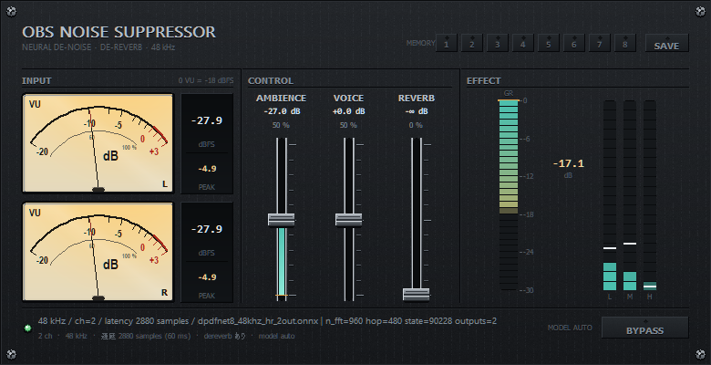

# OBS Noise Suppressor

**OBS Studio 用のネイティブ音声フィルタ（ノイズ抑圧 + 残響抑圧）** です。
ONNX Runtime と DPDFNet モデルを同梱した Windows x64 版で、追加のダウンロードは
要りません。プラグイン ABI・DSP・パネル UI まで**すべて Rust** で書いています。



> 旧 VST3 版 **DPDFNet Voice** を OBS ネイティブに作り直したものです。フィルタ ID
> （`dpdfnet_voice_filter`）は据え置きなので、既存のシーンコレクションはそのまま動きます。

## 特徴

| 項目 | 内容 |
| --- | --- |
| サンプルレート | **48 kHz 専用**。それ以外のレートではパススルー（音は素通し） |
| チャンネル | モノラル → モノラル / ステレオ → ステレオ（OBS の音声設定に追従） |
| 内容遅延 | **2880 サンプル = 60 ms 固定**（`kLatencyHops = 6` × hop 480。VST3 版と同一） |
| 推論 | 同梱の ONNX Runtime 1.31.0（`dpdfnet_onnxruntime.dll`）+ DPDFNet モデル 4 つ |
| モデル選択 | OBS プロパティで **自動 / 高品質 (dp8) / 軽量 (dp2)** を選択 |
| UI | 自前の Win32/GDI パネル（入力 VU 2 本 + 縦フェーダー 3 本 + GR / 3 バンドメーター） |
| プリセット | 1〜8 のスロット（`presets.json` に保存） |
| VU 基準値 | −20 / −18 / −14 dBFS（既定 −18 = EBU）。目盛りが対応 dBFS ごと平行移動 |
| 数値表示 | フェーダーの dB と %、VU の現在値 / ピーク dBFS、GR の抑圧量 dB |
| インストーラー | レジストリ不使用 / 管理者権限不要 / アンインストーラー同梱 |
| 音声スレッド | アロケーションなし（テンソル・バッファは事前確保し `IoBinding` で再利用） |
| 堅牢性 | FFI 境界ごとに `catch_unwind`。落ちずにパススルーへ退避 |

## パネル

OBS のプロパティにある **「パネルを開く（フェーダー / メーター / メモリー）」** で開く、
自前描画のウィンドウです（画像素材やテーマファイルは使っていません）。

| セクション | 内容 |
| --- | --- |
| ヘッダ | タイトル + **メモリー 1〜8**（スロット押下 = 呼び出し / `SAVE` → スロット = 保存 / `Ctrl` + クリック = 消去） |
| INPUT | 入力 L / R の**アナログ VU メーター**（実機準拠の弾道、300 ms で 99 %、行き過ぎなし）と現在値 / ピーク dBFS |
| CONTROL | **縦フェーダー 3 本**（AMBIENCE / VOICE / REVERB）。ダブルクリックで既定値に戻ります |
| EFFECT | **GR メーター**（抑圧量 dB）と出力 **3 バンド（L / M / H）** メーター |
| フッタ | ステータス表示、モデル刻印、**BYPASS**（OBS のフィルタ有効/無効とそのまま同期） |

見た目は実機の業務用機器に寄せています（黒アルマイトの面板 + ヘアライン + 十字ネジ、
アンバーに灯る VU 盤面 + 0 〜 +3 の赤いオーバーロード帯、フェーダーの金属レール）。

## インストール

1. [Releases](https://github.com/TanceMoyashi/OBS-Noise-Suppressor/releases) から
   `OBS-Noise-Suppressor-x.y.z-win64.zip` をダウンロードして展開します。
2. **OBS を終了**して `install.bat` をダブルクリックします（中身は `install.ps1`）。
3. OBS を起動し、音声ソースの「フィルタ」→「OBS Noise Suppressor」を追加します。
4. プロパティの「パネルを開く」でパネルが開きます。

配置先は `%ProgramData%\obs-studio\plugins\obs_noise_suppressor\`
（通常インストーラー版 / Steam 版 / Microsoft Store 版で共通）。ポータブル版の OBS を
検出できた場合は `<OBS>\obs-plugins\64bit\` にも自動でコピーします。
削除は `uninstall.bat` です。

## 動作要件

- OBS Studio 28 以降 / Windows x64（検証は 32.2.2）
- OBS の音声設定が **48 kHz**（設定 → 音声 → サンプルレート）

## ビルド

```powershell
cd clear_re\obs_plugin
.\build.ps1                 # cargo build --release（配布する DLL）
.\build.ps1 -Tests          # cargo test --release --lib（38 テスト）
.\tools\make_package.ps1    # 配布パッケージ (dist\) と ZIP を作る
.\tools\run_obs_verify.ps1  # OBS を実際に回して遅延と DSP を数値で確認する
```

必要なもの:

- Rust（MSVC ツールチェーン）+ Visual Studio の C++ ビルドツール
  （`build.ps1` が `vcvars64.bat` を探します）
- OBS Studio が `C:\Program Files\obs-studio` にあること（`obs.lib` の参照のため）

ONNX Runtime とモデルは `vendor/` と `clear_re/plugin/models/` に入っているので、
クローン直後でもビルドと配置ができます。

## リポジトリ構成

| パス | 内容 |
| --- | --- |
| `clear_re/obs_plugin/` | **現行版**。Rust の OBS プラグイン本体 + ビルド / インストール / 検証ツール |
| `clear_re/obs_plugin/src/` | `filter.rs`（OBS フィルタ）/ `ui.rs`（パネル）/ `dsp/`（DSP と ONNX）/ `meter.rs` / `preset.rs` / `paths.rs` / `ffi.rs` |
| `clear_re/plugin/` | 旧 VST3 版（DPDFNet Voice）。**保守対象外**。DSP の移植元 + モデルの置き場 |
| `clear_re/ANALYSIS.md` | 旧 VST3 版の設計経緯・確定事項 |
| `docs/` | この README 用の画像 |
| `dist/`（未追跡） | `tools/make_package.ps1` が生成する配布パッケージ |

## ドキュメント

| ファイル | 内容 |
| --- | --- |
| `clear_re/obs_plugin/README.md` | 機能・プロパティ・パネル・ファイル構成の詳細 |
| `clear_re/obs_plugin/OBS_VERIFY.md` | 実機検証の手順と結果、トラブルシュート |
| `clear_re/ANALYSIS.md` | 旧 VST3 版の解析（DSP をどう移植したか） |

## 動作確認済みの環境

- OBS Studio 32.2.2 / Windows x64 / ONNX Runtime 1.31.0（`ORT_API_VERSION = 17`）
- 実機 vs オフライン参照が**ビット一致**（998,784 frames × 2 ch / 最大差 `0e0`）
- 遅延 `2880 samples (6.000 hop, 60.0 ms)` 固定
- `cargo test --release --lib` → **38 passed / 0 failed**、ビルド警告 0 件

## ライセンス

- このリポジトリの自作コード: **GPL-2.0-or-later**（[`LICENSE`](LICENSE)）
- ONNX Runtime（`dpdfnet_onnxruntime.dll`）: MIT License（Microsoft）
- DPDFNet モデル（`*.onnx`）: 同梱モデルのライセンスに従います
- 旧 VST3 版の `clear_re/plugin/third_party/kissfft`: 同フォルダの `COPYING` を参照
